# [GBA] Mega Man Zero - Tradução PT-BR

Este é um projeto de tradução do jogo Mega Man Zero, de Gameboy Advance, para português do Brasil. O projeto foi feito com base na versão americana do jogo.

Mega Man Zero é o primeiro jogo da quinta saga da franquia Mega Man. Dessa vez, o jogo é protagonizado pelo Zero, situado cerca de 100 anos após os eventos da saga X.

# Informações

Nome do jogo: Mega Man Zero

Versão: Americana

Plataforma: Gameboy Advance

Desenvolvedora: Capcom

Distribuidora: Capcom

Gênero: Aventura / Plataforma

Jogadores: 1

# Enredo

Cem anos após os últimos acontecimentos dos jogos de Mega Man X, os humanos criaram uma utopia chamada de Nova Arcadia. Seu propósito é proteger a espécie humana de reploides revoltados, chamados de Mavericks, exterminando-os como consequência. Supostamente criada por X, Nova Arcadia repentinamente começa a não distinguir corretamente quem é Maverick e quem é reploide, assim atacando reploides inocentes, taxando-os de Mavericks injutamente.

Para contrapor à Nova Arcadia, um grupo de reploides criou a Base da Resistência, com o objetivo de acolher reploides injustiçados. A líder da Resistência é uma garota humana, chamada Ciel, uma cientista altamente habilidosa. Porém, sem ter como sobreviver aos ataques maciços e impiedosos de Nova Arcadia, a Resistência se via numa situação cada vez pior, com o seu fim estando cada vez mais próximo.

Então, fugindo de Nova Arcadianos numa busca desesperada por uma lenda perdida, Ciel de repente encontra Zero, o reploide lendário que havia lutado junto de X para salvar o mundo 100 anos atrás. Após ser despertado pela Ciel, Zero então passa a ajudá-la a salvar a Base da Resistência do seu fim iminente.

E, o sonho de Ciel, de criar um mundo onde humanos e reploides possam coexistir pacificamente, passa para as mãos de Zero. Este é o começo de uma longa jornada, em busca da paz e a harmonia entre os criadores e as criações.

# Sobre a tradução

Essa foi uma das primeiras traduções que me debutou como romhacker. Feita lá em 2005, minha motivação na época foi porque eu havia traduzido o Mega Man Zero 3 e o Mega Man Zero 2 alguns meses antes, e quis fechar o ciclo traduzindo também o primeiro jogo da série. Na época, já havia uma tradução do finado grupo da Tradu-Roms, feita por \_UNKNOWN\_ lá em 2003, mas que não tinha todos os gráficos editados, e carecia de alguns aspectos textualmente falando, o que me motivou a fazer a minha própria em 2005. Poderíamos até ter juntado esforços e fundido as duas traduções, igual fizemos com o Metroid Fusion em 2008, mas acabou não acontecendo por razões diversas.

A primeira versão de 2005 contava com todos os textos traduzidos e a maioria dos gráficos editados. No lado textual, os ponteiros deles não eram absolutos de 3~4 bytes como de costume em outros jogos de GBA. Ao invés disso, haviam ponteiros absolutos que apontavam para 20 scripts completos, com cada um possuindo um bloco de ponteiros relativos de dois bytes, assim tornando o processo de hacking por ferramentas mais difícil. Isso nos forçou a traduzir o jogo inteiramente por editor hexadecimal, sem remanejar nenhum ponteiro, e tendo que ser criativos para contornar eventuais faltas de espaço aqui e ali. Já no lado gráfico, a maioria estava descomprimido e de edição super facilitada, exceto por meia dúzia de gráficos mais complexos de lidar, como o "Mission Start", "Warning", "Mission Complete", e "Game Over".

Lá por volta de 2019, encorajados pelo surgimento do hack [Mega Man Zero Restoration](https://www.romhacking.net/hacks/3723/), houve uma tentativa minha e do MJay de criar uma versão nova da tradução, aprimorando os pontos faltantes citados acima e fazendo uso opcional de hacks de aprimoramento. Eu até consegui resolver toda a parte gráfica, mas acabei empacando na parte textual, assim engavetando ela na época. Porém, saltando para 2025, descobrimos o repositório [MMZX-GBA-Script-Restoration](https://github.com/StraDaMa/MMZC-GBA-Script-Restoration), do GreigaMaster, contendo ferramentas que que facilitaram a edição textual dos Mega Man Zero da coletânea, assim motivando o MJay a fazer uma retradução de todos os quatro jogos da série, completamente do zero. Em alguns meses, com as ferramentas do GreigaMaster e apoio de romhacking de colegas como Joapeer, Breno, GDK e TTK, ele retraduziu toda a quadrilogia, resultando em um trabalho bem melhor do que antes, que eventualmente será lançado para jogadores de PC. Decidi então usar os scripts dele, ao invés dos meus, como forma de honrar seu trabalho.

Em 2026, iniciei o processo de port dos scripts da retradução do Mega Man Zero 1 do MJay para a versão de GBA. Estudei a forma com as ferramentas do repo do GreigaMaster funcionam, e percebi que ela faz uso do [TextPet](https://github.com/Prof9/TextPet), o mesmo programa que usamos para lidar com a parte textual dos jogos da série Mega Man Battle Network. No repositório, os textos dos jogos foram previamente extraídos para arquivos .tpl editáveis por qualquer editor de texto, e o TextPet consegue converter os .tpl para arquivos binários de extensão .msg estando no mesmo formato esperado pelos jogos. No caso da coletânea, os arquivos .msg são inseridos direto no executável por outras ferramentas dentro do repositório do GreigaMaster, mas no caso da versão de GBA, os arquivos .msg não eram compatíveis, necessitando fazer alguns ajustes em cada um dos 20 scripts do jogo, no processo:

1. Consertar os ponteiros relativos no começo de cada sscript, que devem ser relativos ao arquivo em si e tendo que começar com 0000.
2. Localizar todos os ponteiros absolutos de cada script dentro da rom de GBA, para poder remanejá-los para o final da rom.

Tendo finalizado esse processo, conseguimos tornar todos os scripts da coletânea compatíveis com a versão de GBA. Daí em diante, as semanas seguintes foram de refinamento de gráficos, revisão e testes ingame. E ao que tudo indica, é o mesmo processo para os jogos seguintes da série, a ser visto nos meses seguintes.

Uma coisa que vale citar, é que a tradução faz uso da mesma terminologia usada traduções futuras de outros jogos da série, como Mega Man ZX e Mega Man ZX Advent por exemplo. As mudanças são:

- Diversos termos oriundos da mitologia grega foram adaptados, com "Neo Arcadia" virando "Nova Arcádia", "Fefnir" virando "Fafnir", "Leviathan" virando "Leviatã", etc.
- Nomes de armas foram adaptados, com "Z Buster" virando "Pistola Z", "Z Saber" virando "Sabre Z", "Triple Rod" virando "Lança Tripla", etc.

Outra coisa que foi possível fazer, foi tornar esta tradução compatível com diversos hacks de aprimoramento, como [Mega Man Zero Restoration](https://www.romhacking.net/hacks/3723/), que restaura o sangue vermelho das versões japonesas, e [Mega Man Zero Revisited](https://www.romhacking.net/hacks/7115/), que adiciona diversos aprimoramentos de gameplay. A tradução estará disponível tanto em versão vanilla como combinada com esses hacks, de modo a deixar para o jogador a escolha entre uma ou outra.

Uma última coisa que ainda não mexemos, e que só o faremos futuramente, é fandublagem dos áudios. Nesse jogo, existe meia dúzia de áudios de personagens em japonês, e a ideia seria dublá-los de forma similar à como foi feita no Castlevania Aria of Sorrow. No entanto, ainda requer um certo refino técnico para extrair/inserir os áudios, bem como planejar a melhor abordagem de teste ingame. Como isso será bem trabalhoso, optamos por deixar para um segundo momento.

A tradução será lançada não em uma, mas em duas versões:

- **Vanilla**: Tradução em cima do jogo original, para os que preferem o jogo como ele realmente é.
- **Improved Edition**: Tradução combinada com os seguintes hacks de aprimoramento:
  - [Mega Man Zero Restoration](https://www.romhacking.net/hacks/3723/): Restaura o sangue vermelho, existente na versão japonesa porém removido da americana/europeia, tanto de inimigos como de cenários.
  - [Mega Man Zero Revisited](https://www.romhacking.net/hacks/7115/): Implemente diversos balanceamentos de jogabilidade, como diminuição de _grind_ ao evoluir armas, redução de cristais para crescimento de cyber-elfos, reduzida penalização de uso de cyber-elfos em missões, etc.

Com isso, depois de mais de 20 anos, conseguimos finalmente lançar uma tradução 100% desse jogo. Espero que usufruam da tradução, da mesma forma que também o fizemos em todo esse processo.

# Trabalho Humano vs Inteligência Artificial

Decidi adicionar esse aviso nas minha traduções para fins de transparência, quanto a quais áreas dela teve envolvimento de IA e quais não tiveram.

Na parte criativa, todos os textos foram traduzidos por humanos. Os gráficos também foram todos editados à mão. A revisão e teste ingame também foi toda feita por nós jogadores, manualmente.

Na parte de ferramentas, a grande maioria delas foi escrita à mão, porém algumas ferramentas menores foram criados com IA, mediante explicação da lógica desejada para o mesmo. Além disso, foi utilizado autocompletação de texto provindo do GitHub Copilot, para agilização de trabalhos repetitivos diversos.

Dito isso, pode-se dizer que **95%** da tradução foi feita por trabalho humano. Isso pode ser aferido diretamente no código-fonte do projeto, indo em https://github.com/leomontenegro6/megaman-zero-1-traducao-ptbr.

# Equipe

- **MJay**: Retradução para a coletânea, gráficos e teste;
- **Solid One**: Tradução original, e porte para versão de GBA;
- **Joapeer**: Romhacking;
- **Breno**: Romhacking;
- **GDK**: Romhacking;
- **Gustavo Fraga**: Revisão;
- **GreigaMaster**: Ferramentas de hacking textual avançado.

# Agradecimentos

- Capcom, por ter lançado o jogo;
- ao \_UNKNOWN\_, do finado grupo da Tradu-Roms, por ter feito a primeira tradução desse jogo lá em 2003.
- Ao MJay, por ter tocado a retradução desse jogo, que estou utilizando;
- GreigaMaster, pela ferramenta de edição de textos que agilizou bastante esse relançamento;
- Joapeer, Breno, GDK e TTK, pelo apoio de romhacking e ferramentas adicionais.
- Ao pessoal do F.U.R.T. e do grupo MegaMan Brasil, pelo apoio geral.

# Status da Tradução

Textos: 100%

Acentos: 100%

Gráficos: 100%

Revisão: 100%

# Perguntas e Respostas

**P1**: É possível eu ter uma versão contendo o hack de aprimoramento do "Restoration", porém não do "Revisited", ou vice-versa?

**R1**: Para esse caso, recomendo o patcheamento manual. Pegue a rom original, aplique primeiro os hacks de aprimoramento de sua preferência, e só depois aplique o patch da tradução em sua versão vanilla.

**P2**: Vi que a versão nova aumentou o tamanho da ROM de 8mb para 16mb. Por que isso foi feito, se a rom tem espaço de sobra e não precisaria expandir?

**R2**: Foi necessário expandir a rom devido à forma como a ferramenta TextPet funciona. A rom possui uma área livre muito pequena no final, e para que seja possível comportar os textos traduzidos, por vezes maior que o original, o tamanho da rom foi aumentado de 8mb para 16mb, com os textos sendo inseridos a partir do início da área expandida.

# Imagens

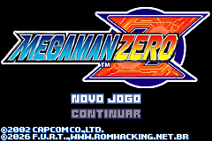 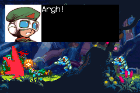 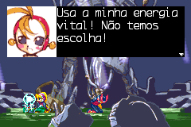

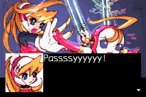 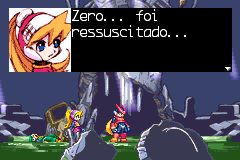 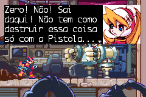

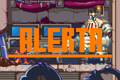 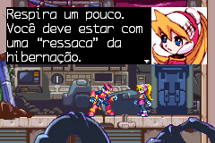 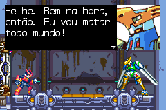

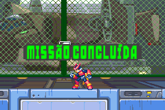 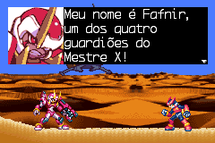 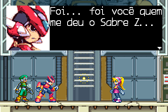

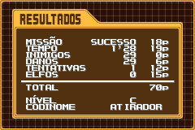 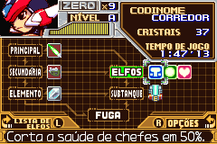 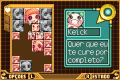

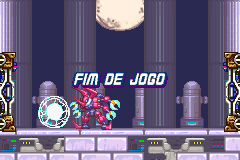

# Patch

Os patches de tradução estão disponível na seção de releases desse repositório. Estão em formatos IPS ou BPS, e você pode aplicá-los através de programas como [Floating IPS](https://www.romhacking.net/utilities/1040/) ou similares.

Esta tradução pode ser aplicada na ROM "Megaman Zero (U).gba", com header, de crc 9707D2A1 / md5sum b24a17d080a01a404cbf018ba42b9803.

[*Download*](https://github.com/leomontenegro6/megaman-zero-1-traducao-ptbr/releases)